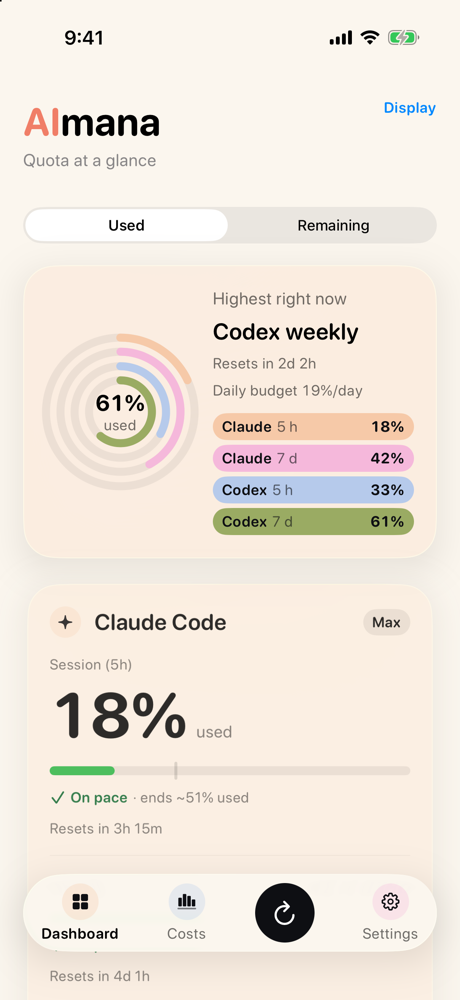
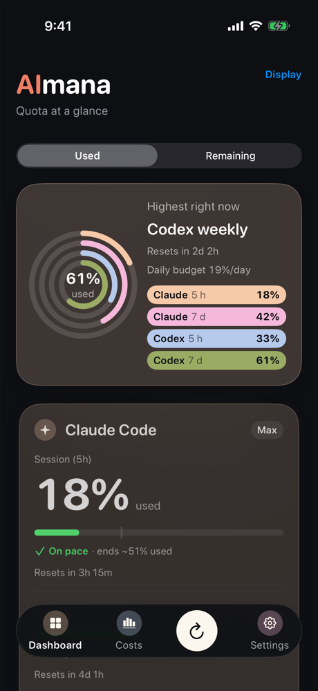
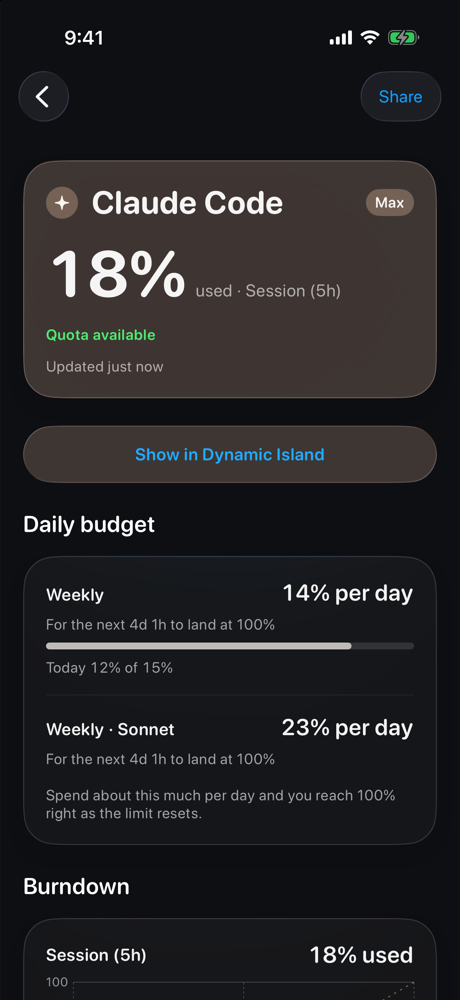
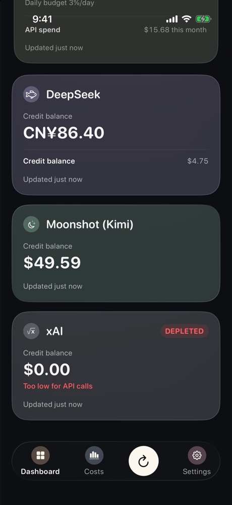
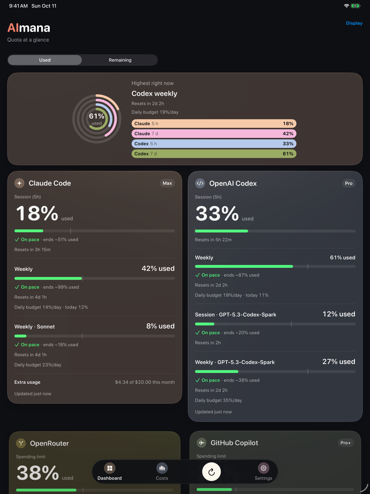
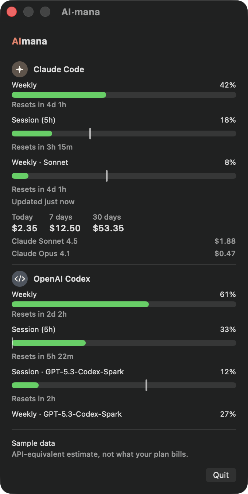
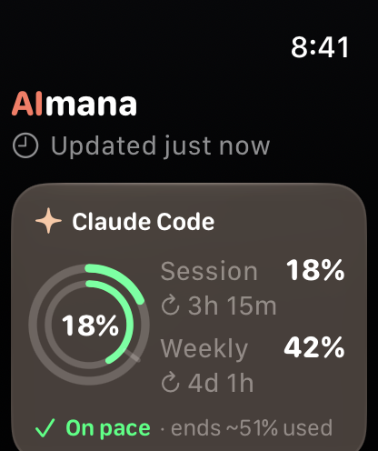

# AI·mana

**Tus cuotas y tu gasto en herramientas de IA para programar, nativo en iPhone, iPad, Apple Watch y Mac.**

[English](README.md)

AI·mana muestra:
- cuánto llevas usado de tus límites de Claude Code y Codex;
- cuándo se reinicia cada ventana;
- si a tu ritmo se te acabará antes del reinicio;
- cuánto costaría ese uso a precios públicos de la API.

También sigue el saldo prepago de proveedores de API directamente desde el iPhone, sin Mac.

Es gratis y de código abierto (MIT). No tiene cuenta ni servidor, y usa **solo fuentes de datos oficiales**.

> AI·mana es un proyecto independiente. No está afiliado a Anthropic, OpenAI, GitHub, OpenRouter, DeepSeek, Moonshot
> AI ni xAI, ni cuenta con su respaldo o patrocinio. Sus nombres se usan solo para indicar compatibilidad.

<p align="center">
  
  
  
  
</p>

<p align="center">
  
  
  
</p>

## Funciones

**iPhone y iPad**
- Panel con cada ventana de 5 horas y semanal, mostrada como usado o restante, en barras o anillos.
- Proyección de ritmo: ¿llegarás al límite antes del reinicio?
- Costos estimados equivalentes a la API, con historial. Se calculan en tu Mac a partir de los contadores locales
  de tokens.
- Widgets de pantalla de inicio y de bloqueo, botón interactivo de actualizar y control en el Centro de Control.
- Live Activity y Dynamic Island para el proveedor que estás siguiendo.
- Siri y Atajos (por ejemplo "How much Claude is left in AI·mana?"; las frases de Siri están en inglés).
- Notificaciones de ritmo rápido, de cuota disponible otra vez y un resumen diario.
- Seis idiomas: español, inglés, portugués (Brasil), francés, alemán e italiano.

**Apple Watch**
- App y complicaciones para la esfera, sincronizadas desde el iPhone.

**Mac (barra de menú)**
- Lee los datos oficiales del statusline de Claude Code (`rate_limits`), sin credenciales.
- Lee los logs locales de sesión de Codex (`~/.codex/sessions`).
- Estima costos a partir de los contadores locales de tokens y de los precios públicos de los modelos.
- Publica un archivo de resumen en tu iCloud Drive para el iPhone. No contiene credenciales ni prompts.

**Proveedores de API, en el iPhone y sin Mac** (con tu propia clave)
- OpenRouter, GitHub Copilot, DeepSeek, Moonshot (Kimi) y xAI. Las claves quedan en el Llavero de iOS.

## Cómo funciona

```
Statusline de Claude Code ─┐
                           ├─▶ AI·mana para Mac, o usage-relay ─▶ usage-relay.json ──────▶ iPhone · iPad · Watch
Logs de sesión de Codex ───┘   en Windows y Linux                 en iCloud Drive u OneDrive

Tus claves de API ───────────────────────────────────────────────────────────────────────▶ se leen en el iPhone
```

El iPhone lee el resumen que publica tu computadora. Las consultas a los proveedores de API van directo desde tu
dispositivo a ese proveedor. AI·mana no tiene servidor ni analítica. Ver [PRIVACY.md](PRIVACY.md).

## Primeros pasos

La configuración tiene tres pasos. Síguelos en orden.

### Qué necesitas

- Un iPhone o iPad con iOS / iPadOS 17 o posterior (Apple Watch: watchOS 10 o posterior).
- Un Mac con Xcode 26 o posterior, para instalar la app del iPhone. AI·mana aún no está en la App Store.
- Un Apple ID. Sirve una cuenta gratuita, pero Apple hace que las apps compiladas con ella venzan a los 7 días, así
  que tendrás que recompilar cada semana.
- Para las cuotas de Claude Code y Codex: la computadora donde los usas (Mac, Windows o Linux) y una carpeta que
  comparta con tu iPhone (iCloud Drive u OneDrive). Los saldos de API no necesitan computadora.

### Paso 1: instala la app en tu iPhone

1. Instala [XcodeGen](https://github.com/yonaskolb/XcodeGen): `brew install xcodegen`.
2. Descarga el código y prepara la configuración:

   ```bash
   git clone https://github.com/p4ranoic0/AI-mana.git AImana
   cd AImana
   cp AImana/Config/Local.xcconfig.example AImana/Config/Local.xcconfig
   ```

3. Edita `AImana/Config/Local.xcconfig`: pon tu Team ID y un prefijo de bundle propio (por ejemplo `com.tunombre`).
4. Genera y abre el proyecto:

   ```bash
   cd AImana && xcodegen generate && open AImana.xcodeproj
   ```

5. Conecta tu iPhone, elige el esquema `AImana` y tu dispositivo, y pulsa Run.

Si solo quieres seguir saldos de API, ya terminaste: añade tus claves en los ajustes de la app.

### Paso 2: publica tu uso desde tu computadora

Hazlo en la computadora donde usas Claude Code o Codex. Elige tu sistema:

**Mac**

1. En el mismo proyecto de Xcode, elige el esquema `AImanaMac` y **My Mac**, y pulsa Run. La app aparece en la
   barra de menús.
2. En sus ajustes, instala la integración del statusline de Claude Code y comprueba que iCloud Drive esté
   disponible.

La app publica sola `iCloud Drive/AImana/usage-relay.json`.

**Windows**

1. Instala [Scoop](https://scoop.sh/) si no lo tienes y luego, en PowerShell:

   ```powershell
   scoop bucket add aimana https://github.com/p4ranoic0/scoop-bucket
   scoop install usage-relay
   usage-relay setup
   ```

2. `setup` muestra la ruta del archivo publicado. Tenla a mano para el paso 3.

Sin Scoop: descarga el ZIP de Windows desde [Releases](https://github.com/p4ranoic0/AI-mana/releases), extrae todos
los archivos en una misma carpeta y ejecuta `.\usage-relay.exe setup` desde ella.

**Linux**

1. Instálalo con [Homebrew](https://github.com/p4ranoic0/homebrew-tap), o descarga el archivo de Linux desde
   [Releases](https://github.com/p4ranoic0/AI-mana/releases):

   ```sh
   brew install p4ranoic0/tap/usage-relay
   ```

   El binario necesita la biblioteca `libcurl` del sistema (en Ubuntu: `sudo apt install libcurl4`).
2. Publica en una carpeta que se sincronice con tu iPhone:

   ```sh
   usage-relay setup --output /ruta/a/la/carpeta/sincronizada/usage-relay.json
   ```

`setup` encuentra tus datos de Claude Code y Codex, publica una vez, instala la captura del statusline de Claude y
programa una publicación cada cinco minutos en segundo plano (una tarea oculta en Windows, un timer de systemd del
usuario en Linux).

### Paso 3: conecta el iPhone

1. Abre AI·mana en tu iPhone y ve a **Ajustes › Tu computadora**. En el primer uso, el panel muestra el mismo
   botón.
2. Toca **Elegir archivo del relay…** y elige `usage-relay.json` en el selector de Archivos (carpeta
   `iCloud Drive/AImana`, o la que mostró `setup`).
3. Tus cuotas de Claude Code y Codex aparecen en el panel. Añade los widgets, la app del Watch o la Live Activity si
   quieres.

### Si algo no aparece

- En Windows o Linux: ejecuta `usage-relay doctor`. Revisa cada parte y te dice cómo arreglar lo que falte.
- Los datos de Claude Code aparecen después de tu siguiente mensaje en Claude Code, cuando se ejecuta su statusline.
- iCloud para Windows puede tardar en subir el archivo. OneDrive también funciona en el selector de Archivos del
  iPhone.
- Para quitar la tarea en segundo plano y restaurar tu statusline anterior: `usage-relay uninstall`.

## Más detalles

### Actualizar

- App del iPhone y del Mac: `git pull` y vuelve a ejecutar los esquemas desde Xcode.
- Windows: `scoop update usage-relay`. Linux: `brew upgrade usage-relay`. La tarea en segundo plano sigue funcionando.

### Referencia del relay

`usage-relay setup [--output ARCHIVO] [--interval MINUTOS]`, `doctor`, `uninstall`, `run [--output ARCHIVO]`,
`check ARCHIVO`, `costs` y `--version`. La salida predeterminada es `iCloudDrive/AImana/usage-relay.json` en Windows
si existe iCloud Drive (si no, OneDrive; si no, `AImana` en tu carpeta de usuario), y `~/AImana/usage-relay.json` en
Linux. Si Linux no tiene systemd, `setup` te muestra una línea de crontab para que la añadas. En Linux el estado usa
`${XDG_DATA_HOME:-~/.local/share}/aimana` y las cachés `${XDG_CACHE_HOME:-~/.cache}/aimana`; en Windows,
`%LOCALAPPDATA%\AImana`. Para compilar el relay desde el código: `swift build -c release --package-path AImana/Relay`.

**WSL:** el binario de Linux también funciona dentro de WSL. Si Claude Code y Codex corren en Windows, apúntalo a sus
datos de Windows y publica en la carpeta sincronizada de Windows:

```sh
WINHOME="$(wslpath "$(cmd.exe /C 'echo %USERPROFILE%' | tr -d '\r')")"
CLAUDE_CONFIG_DIR="$WINHOME/.claude" CODEX_HOME="$WINHOME/.codex" \
  usage-relay setup --output "$WINHOME/iCloudDrive/AImana/usage-relay.json"
```

### Tests

Ejecuta `swift test` en `AImana/AImanaCore` y en `AImana/Relay`.

## Cuando un proveedor cambia algo

AI·mana depende de formatos que controlan otras empresas, y pueden cambiar sin aviso. El parser de cada proveedor
está aislado y cubierto por tests con datos de ejemplo. Si ves números raros, abre un issue con la plantilla
**Provider changed**.

## Apoya el proyecto

AI·mana es gratis. Si te ahorra quedarte sin cuota a mitad de una tarea, puedes apoyar su desarrollo:

- [Ko-fi](https://ko-fi.com/post/AImana-your-AI-coding-quotas-on-iPhone-Watch-an-S1D028MW28): única o mensual, con tarjeta o PayPal. Escribe "AI·mana" en tu mensaje.
- Yape (desde Perú): escanea este código QR con la app de Yape.


También ayudan las estrellas, los reportes de errores y las traducciones.

## Contribuir

Ver [CONTRIBUTING.md](CONTRIBUTING.md). Problemas de seguridad: [SECURITY.md](SECURITY.md).

## Licencia

[MIT](LICENSE)
